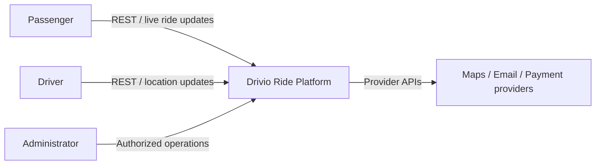
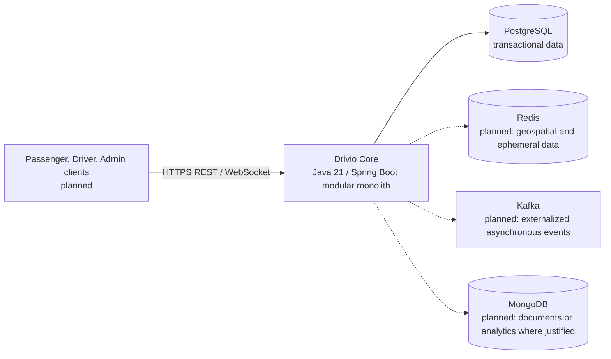

# Architecture Baseline

## Decision

Start with a modular monolith. Modules are organized by business capability and
use inward-facing dependencies: interfaces and infrastructure depend on
application ports; application coordinates domain behavior; domain remains
framework-independent. Extract a module into a service only when deployment,
ownership, scaling, or availability requirements justify the operational cost.

## C4: system context



## C4: initial containers



Solid edges are part of the current baseline; dashed edges are planned and must
not be represented as implemented capabilities. The local Compose environment
currently provides PostgreSQL only.

## Module boundaries

```text
com.drivio
  iam/          identity, credentials, authentication, authorization
  passenger/    passenger profile and preferences
  driver/       onboarding, documents, approval, vehicle, availability
  ride/         ride aggregate and lifecycle (core domain)
  vehicle/      vehicle concepts owned by the driver workflow initially
  payment/      post-ride payment state and provider ports
  notification/ notification use cases and adapters
  bootstrap/    composition root and cross-cutting framework configuration
  shared/       small, stable cross-context primitives only
```

Modules may communicate through application ports or in-process domain events;
they must not access another module's persistence tables or internal classes.
Infrastructure-specific event brokers are adapters, not domain dependencies.

## Data and event principles

- PostgreSQL is the source of truth for transactional business state.
- Redis is reserved for expiring/cache/geospatial data with an explicit
  PostgreSQL recovery strategy where required.
- Payment and notification work is triggered after domain state changes. A
  durable outbox and idempotent consumers are required before relying on a
  broker for business-critical delivery.
- Money uses decimal/fixed-precision values and a currency; floating-point
  arithmetic is prohibited for fares or payments.
- Domain entities and value objects contain business behavior and do not depend
  on Spring, JPA, Jackson, Kafka, or Redis.

## Test architecture

- Domain unit tests verify value objects, aggregate transitions, and invariants.
- Application tests verify use-case orchestration through ports.
- Adapter tests verify persistence, HTTP, messaging, and provider contracts.
- End-to-end tests verify critical journeys against production-like dependencies.

The first CI gate builds and runs the existing tests with PostgreSQL. Coverage,
static-analysis, and dependency-vulnerability gates will be tightened as their
scope and baselines are implemented, without hiding existing violations.